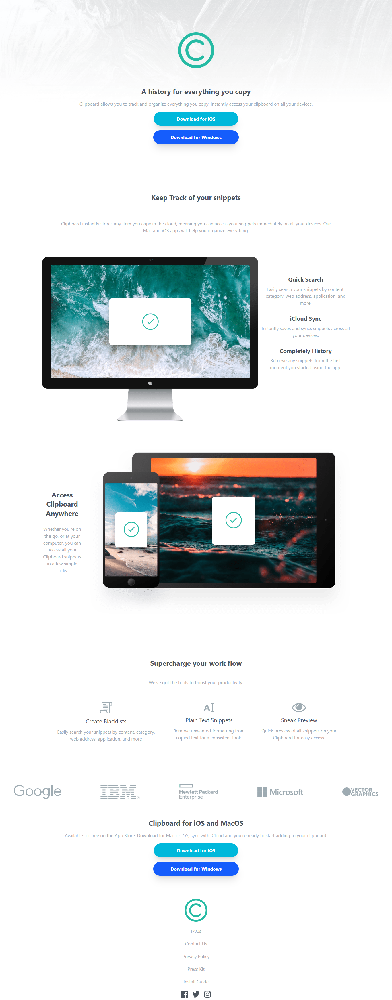

# My-Study-For-Tailwind-CSS
I am preparing myself to master ReactJs { tailwind is a must (: }

# Project

I woke up this morning and put together a neat little project using Tailwind. Honestly, it’s a fantastic library , it might just become my go-to, replacing Bootstrap. You barely have to write any actual CSS; you just work with classes—there are even classes for animations, transitions, and pseudo-classes! Even the way it handles responsiveness is better than Bootstrap. You simply add a prefix like `md:` followed by whatever style you want—for example, `flex-row` or `w-1/2`—which then applies to medium-sized screens and up. In Bootstrap, by contrast, you’d use something like `flex-md-row`, and it was limited to specific properties—I don’t even think you could apply things like width based on `md` or `sm` breakpoints.

